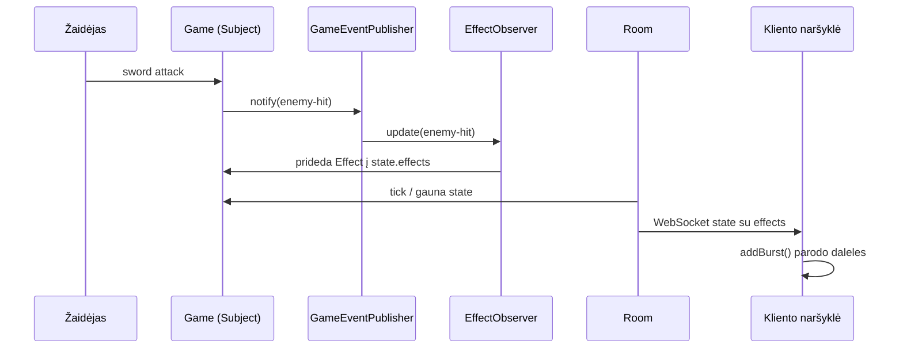

# Observer veikimo sekų diagrama

Pavyzdys: žaidėjas kardu pataiko priešą. `Game` nežino, kas kurs efektą. Jis tik paskelbia įvykį. `EffectObserver` jį gauna ir įdeda efektą į būseną, kurią `Room` jau siunčia klientams.

